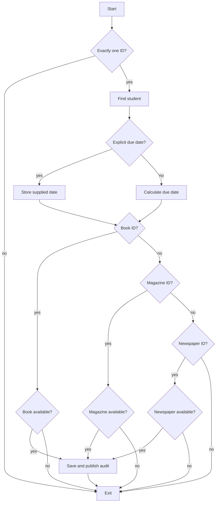

# SonarQube baseline and cyclomatic complexity (#12)

The [GitHub Actions run](https://github.com/Artfever/libris-SQE-Project/actions/runs/44898526072)
analyzed revision `f3fb34d18642c766dc20e054b52b61798500ff12`, the pull request
merge revision. It used SonarQube Community Build 26.11.0.134175,
Sonar Maven scanner 5.5.0.6356, Java 21, JaCoCo 0.8.12, and the Java
Sonar way core profile (263 rules). The gate reported OK. Raw API
responses are next to this report, including the gate, profile and revision.

The CI workflow starts an ephemeral server with the version above. To
reproduce the scan against a running local server with a private token
in the environment, execute the following command from backend. The
workflow exports metrics and the quality gate from the SonarQube API
before stopping the server.

```sh
mvn -B clean verify org.sonarsource.scanner.maven:sonar-maven-plugin:5.5.0.6356:sonar -Dsonar.projectKey=libris-sqe -Dsonar.coverage.jacoco.xmlReportPaths=target/site/jacoco/jacoco.xml -Dsonar.qualitygate.wait=true -Dsonar.qualitygate.timeout=300
```

| Metric | Java project | BorrowRecordService | Interpretation |
| --- | ---: | ---: | --- |
| Cyclomatic complexity | 513 | 39 | Independent paths add verification effort. The file repeatedly branches on item type and return state. |
| Cognitive complexity | 214 | 29 | Branch nesting and dispatch contribute to reading effort. |
| Duplication | 1.7% | — | Repeated lines can require coordinated changes. |
| Code smells | 4 | — | Maintainability warnings are candidates for review and refactoring. |
| Bugs | 0 | — | Active rules reported no bugs in this scan. |
| Vulnerabilities | 1 | — | A project-level finding requires triage. The count alone does not establish runtime impact. |
| Coverage | 87.7% | 97.9% | Sonar combines line and condition coverage from the baseline JaCoCo data. These are combined baseline results rather than team-only unit coverage. |
| Technical debt | 80 min | — | Estimated remediation effort for maintainability findings. |
| Maintainability rating | A | A | Ratio of estimated remediation effort to codebase size. |
| Reliability rating | A | A | Rating based on detected reliability issues. |
| Security rating | B | A | Project-wide rating reflects a detected security issue. |
| Source lines | 4124 | 229 | Size provides context for these aggregates. |

The dash denotes a metric omitted by the file API. The quality gate
uses its configured conditions and does not imply all overall scores are ideal.

## Manual CFG for borrow

The graph merges exceptions and normal completion into a single exit. In
this first graph, library call internals are treated as opaque. Availability
tests branch to exit when the item is unavailable.



Fourteen nodes and 21 edges give E − N + 2 = 21 − 14 + 2 = **9**.
The count includes the final defensive dispatch edge as written in the
source, although that path is infeasible after the count guard.

The four explicit not-found suppliers cover student and each item type.
Adding their exceptional edges in a graph that models those lookups gives
25 edges and the same 14 nodes when the lookups are represented at their
respective source nodes. This gives **13**. SonarJava counts the four arrow
expressions, so hand application of its counting convention also yields 13.
SonarQube exposes the file aggregate, and the per-method entries below
reconcile against the tool's measured **39**.

| Method | Manual SonarJava count |
| --- | ---: |
| Constructor | 1 |
| list | 5 |
| listByStudentId | 3 |
| listByCurrentStudent | 2 |
| borrow | 13 |
| returnBook | 10 |
| response | 5 |
| Total | 39 |

[SonarQube metric definitions](https://docs.sonarsource.com/sonarqube-server/2026.1/user-guide/code-metrics/metrics-definition)
describe the Java counting convention and file aggregation.

Codex added the export, checked downloaded metrics against the artifact,
and reviewed the branch count against source and SonarJava documentation.
Team review is pending.
